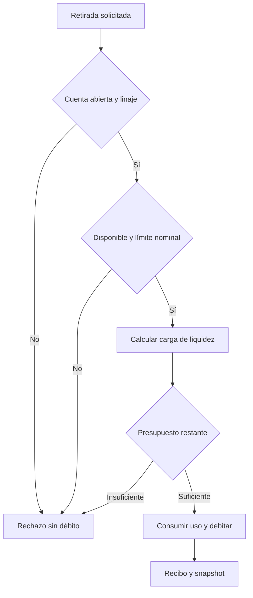
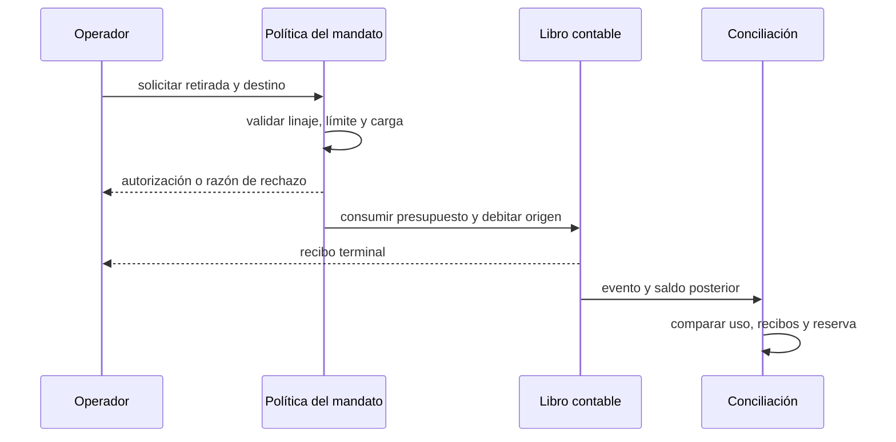

# Presupuesto de liquidez de mandatos

Un mandato puede fijar un presupuesto de riesgo adicional a sus límites
diario, de retirada y de settlement. El control se aplica a la retirada real,
antes de modificar el libro y emitir el recibo externo. Es opcional: los
mandatos sin `risk_budget` conservan sus límites nominales anteriores.

`liquidity_reference` define la escala inicial de capacidad de la época y
debe cubrir el límite de retirada del mandato. `risk_budget` expresa la
máxima carga de liquidez admitida durante esa época, en unidades enteras del
activo. `used_withdrawals` y `risk_used` son acumuladores observables. La
carga es convexa respecto al importe de cada orden y se redondea hacia arriba.
El control de cuenta y linaje se evalúa antes de consumir cualquier presupuesto.
La referencia no puede superar el saldo disponible de la cuenta matriz en el
alta; el presupuesto tampoco puede superar esa referencia.



Ejemplo de alta por escenario:

```json
{
  "type": "create_mandate",
  "mandate_id": "mandate-eu-ops",
  "parent": "inst-hot",
  "delegate": "delegate-eu-ops",
  "asset": "USDC",
  "daily_limit": 1000000000000,
  "withdrawal_limit": 1000000000000,
  "settlement_limit": 1000000000000,
  "direct_withdrawal": true,
  "liquidity_reference": 1000000000000,
  "risk_budget": 400000000000
}
```

Con referencia de 1.000.000 USDC y presupuesto de 400.000 USDC, una orden
aislada de 400.000 USDC consume 160.000 USDC de carga; una orden única de
1.000.000 USDC se rechaza. El cliente debe consultar el estado del mandato
después de cada recibo, no inferir capacidad a partir del saldo bruto. Cada
importe se expresa en la unidad menor del activo configurado: para seis
decimales, 1.000.000 USDC se transmiten como `1000000000000` unidades base.



El informe de capital por segregación sigue siendo una vista independiente:
recortes de reserva, shocks de salidas, coste operativo, concentración y
liquidez agregada. La conformidad del mandato no equivale a conformidad del
portafolio; ambos dominios se reconcilian por activo y por época. Una
restricción de retirada heredada de una cuenta ancestro prevalece aunque una
cuenta hija tenga una capacidad operativa propia.
